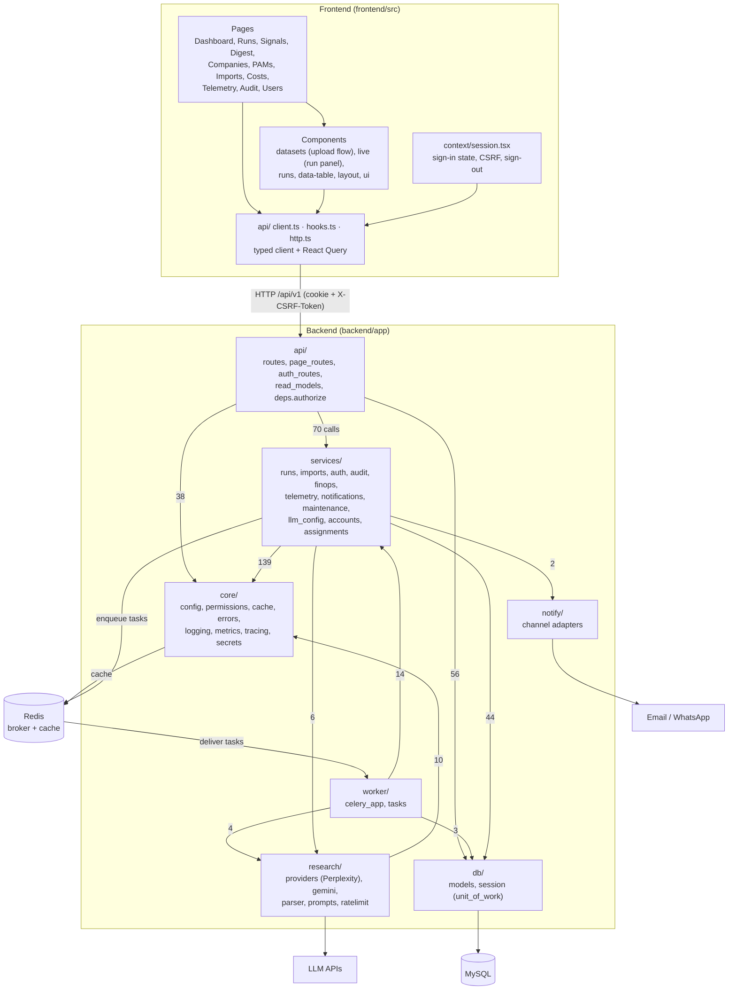
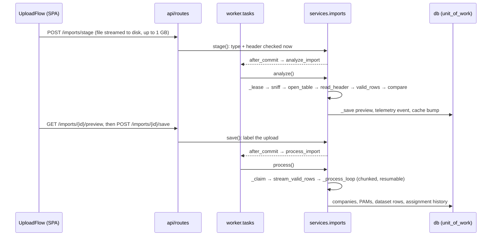
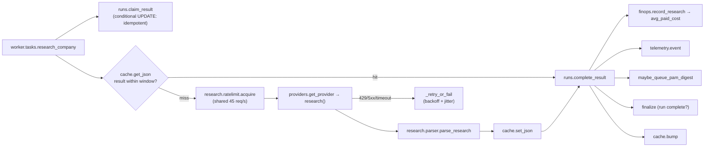

# Architecture

This document explains how the TTBS Live News Feed code is organised and how its main flows run.
It is generated from the GitNexus knowledge graph of this repository: 174 source files,
3,592 symbols, 8,002 relationships, 309 execution flows. The call counts quoted below come from
that graph. For running and deploying the system, see [README.md](README.md) and
[deploy/README.md](deploy/README.md).

## Overview

The system has three runtime parts that share one database:

- **API** (`backend/app/api`, FastAPI): serves the React SPA's requests. Every request passes one
  permission guard. The API reads through a Redis cache and writes through services, inside a
  single unit of work per request.
- **Workers** (`backend/app/worker`, Celery): run the long jobs:
  - parsing uploads
  - researching each company with an LLM
  - delivering digests
  - a periodic maintenance tick
- **Frontend** (`frontend/src`, React): pages built on a typed API client, React Query hooks and a
  session context.

All business rules live in `backend/app/services`. Both the API and the workers call them, so
the same rule applies whichever side starts the action.



Edge labels are counts of static call edges between packages. `core` is the most depended-on
package, `services` the busiest, and nothing in `core` or `db` depends on `services`.

## Functional areas

The groups below combine GitNexus's auto-detected clusters (Leiden communities) with the folder
each one lives in.

### Backend

| Area | Where | Responsibility | Key symbols |
|---|---|---|---|
| **API** (largest cluster, ~320 symbols) | `api/routes.py`, `page_routes.py`, `auth_routes.py`, `read_models.py`, `schemas.py` | HTTP endpoints, request/response models, read models for the pages | `create_run`, `get_run`, `list_runs`, `dashboard`, `activate_llm_provider` |
| **Access control** | `api/deps.py`, `core/permissions.py` | One guard on every router. It classifies the matched route template as PUBLIC, SESSION, SIGNED_IN, ADMIN or a module, then checks the session, CSRF token and permission level. It fails closed. | `authorize`, `current_principal`, `current_actor`, `classify`, `allows` |
| **Services** (~200 symbols) | `services/*` | Business rules and transactions | see below |
| ↳ Runs | `services/runs.py` | Create, start and finish runs; claim and complete per-company results; queue each PAM's digest | `create_run`, `start`, `claim_result`, `complete_result`, `maybe_queue_pam_digest` |
| ↳ Imports | `services/imports.py` | Analyse an uploaded Excel/CSV, then save it in leased, resumable chunks | `analyze`, `process`, `_lease`, `_process_loop`, `stalled` |
| ↳ Auth | `services/auth.py`, `services/passwords.py` | Sign-in, sessions, lockout, password policy and history, user management, bootstrapping the first admin | `login`, `resolve_session`, `change_password`, `create_user`, `hash_password` |
| ↳ Audit | `services/audit.py` | Hash-chained audit log, serialised with an advisory lock | `record` (→ `advisory_lock`) |
| ↳ FinOps | `services/finops.py` | Cost ledger, budget check, cost report | `check_budget`, `record_research`, `record_message`, `month_spend` |
| ↳ Telemetry | `services/telemetry.py` | `process_events` behind every timeline | `event`, `event_now` |
| ↳ Notifications | `services/notifications.py` | Digest delivery with backoff, and resend | `deliver`, `resend`, `backoff_seconds` |
| ↳ Maintenance | `services/maintenance.py` | Dispatcher tick: promote scheduled runs and recover stuck work | `tick`, `promote_scheduled_runs`, `recover_stuck` |
| ↳ LLM config | `services/llm_config.py` | Per-provider key, model and activation (one active provider) | `save`, `test`, `activate` |
| **Research** | `research/*` | LLM calls (Perplexity, Gemini with Google Search), prompt text, parsing answers into signals, shared rate limiter | `get_provider`, `research`, `parse_research`, `acquire` |
| **Worker** | `worker/celery_app.py`, `worker/tasks.py` | Celery wiring (queues `research`, `notify` and `maintenance`), with thin tasks that call services | `research_company`, `start_run`, `send_notification`, `process_import`, `analyze_import`, `tick` |
| **Notify** | `notify/adapters.py` | Channel adapters behind one interface (currently `console`) | `get_adapter`, `ConsoleAdapter.send` |
| **Core** | `core/*` | Settings, read-through cache with namespace versions (`bump`), error envelope, JSON logging, Prometheus metrics, OpenTelemetry, AES-GCM secrets | `get_settings`, `cached`, `bump`, `get_json` / `set_json` |
| **Db** | `db/models.py`, `db/session.py` | SQLAlchemy models; `unit_of_work` (one transaction, with after-commit hooks for enqueueing tasks); advisory locks | `unit_of_work`, `after_commit`, `advisory_lock`, `get_engine` |
| **Tests** | `backend/tests/*` | pytest on SQLite + fakeredis with eager Celery. Covers auth, datasets, pipeline, providers, pages, FinOps. | `conftest.make_user`, `sign_in` |

### Frontend

| Area | Where | Responsibility |
|---|---|---|
| **App shell and routing** | `App.tsx`, `components/layout/*` | Routes. `Guard` redirects to sign-in or a forced password change; `Allow` gates by module or admin; the nav shows only what the user can open. |
| **Session** | `context/session.tsx` | Restores the session from `/auth/me`, keeps the CSRF token in memory, and clears the query cache on sign-out |
| **API layer** | `api/http.ts`, `client.ts`, `hooks.ts`, `types.ts` | One `request()` (credentials, CSRF on writes, no-store, error envelope), a typed endpoint client, and React Query hooks |
| **Pages** | `pages/*` | Dashboard, Runs (list and detail), Signals, Digest, Companies, PAMs, Imports, Templates, Integrations, Costs, Telemetry, Audit, Users, Login, ChangePassword |
| **Datasets** | `components/datasets/*` | Upload flow: pick a file, analyse it, preview, research plan, save |
| **Live** | `components/live/*` | Live run panel and grid; `useLiveRun` polls only while a run is active |
| **Runs, Companies, Pickers, Integrations** | `components/*` | New-run dialog, run insights, reassign dialog, scalable PAM/logo pickers, AI provider settings |
| **UI kit** | `components/ui/*`, `components/data-table/*` | shadcn/Radix primitives and a server-paged data table |

## Key execution flows

These are the step traces from the graph, simplified to the main path.

### 1. Upload a dataset (analyse, then save)



The steps are leased and resumable. `maintenance.recover_stuck` calls `imports.stalled`,
`stalled_checks` and `discard_stale_previews` to pick up uploads whose worker died.

### 2. Create and start a run

Trace `Create_run → Get_settings`:

```
api.routes.create_run
  └─ services.runs.create_run
       ├─ finops.check_budget → month_spend → month_start   (hard cap on new runs)
       ├─ research.providers.get_provider                    (an active LLM is required)
       ├─ scope_count, import_id_of                          (the run covers one upload)
       ├─ audit.record, telemetry.event, cache.bump
       └─ _enqueue_start  (after_commit: queued only if the transaction commits)

worker.tasks.start_run
  └─ services.runs.start
       ├─ _members                                           (the upload's logos + PAMs)
       ├─ audit.record, telemetry.event, cache.bump
       └─ _enqueue_research × N  (after_commit)
```

### 3. Research one company (the hot path)

Trace `Research_company → Utcnow`, plus the task's direct calls:



`complete_result` is the convergence point: success, cache hit, failure and budget-exceeded all go
through it. That is why the cost ledger, telemetry and the run's progress can never disagree.

### 4. Deliver a digest

```
worker.tasks.send_notification          (queue: notify)
  └─ services.notifications.deliver
       ├─ notify.adapters.get_adapter → send
       ├─ finops.message_price, finops.record_message
       ├─ audit.record, telemetry.event, cache.bump
       └─ on failure: backoff_seconds → retried up to NOTIFY_MAX_ATTEMPTS
```

### 5. Every request: authorisation

```
api.deps.authorize(request)            (a dependency on every /api/v1 router)
  ├─ core.permissions.classify          route template → PUBLIC | SESSION | SIGNED_IN | ADMIN | module
  ├─ services.auth.resolve_session      cookie → _token_hash → session row (idle / expiry / revoked)
  ├─ CSRF check on unsafe methods
  ├─ services.auth.password_expired     forced change → 403 password_change_required
  └─ effective_permissions → required_level → allows
```

`current_actor` (used by about 19 write endpoints) resolves through `current_principal`, so the
audit actor is always the signed-in user.

### 6. Sign-in and the audit chain

Trace `Login → Advisory_lock`:

```
api.auth_routes.login
  └─ services.auth.login
       ├─ normalize_username → verify_password (dummy hash for unknown users) → needs_rehash
       ├─ lockout accounting, _new_session (rotated token, CSRF token)
       └─ audit.record → db.session.advisory_lock   (serialises the hash chain)
```

### 7. Maintenance tick (beat, every `DISPATCHER_INTERVAL_S`)

```
worker.tasks.tick → services.maintenance.tick
  ├─ promote_scheduled_runs   _skip_locked → _enqueue_start
  └─ recover_stuck            re-enqueue lost start/research tasks; recover stalled uploads
```

## Cross-cutting patterns

| Pattern | Where | Why |
|---|---|---|
| Unit of work with after-commit hooks | `db.session.unit_of_work`, `after_commit` | Tasks are enqueued only after the transaction that created them commits: no phantom work |
| Idempotent claims | `runs.claim_result`, `imports._claim`, `_lease` | Redelivered or duplicate tasks are harmless; the sweeper can re-enqueue freely |
| Namespace cache versioning | `core.cache.cached`, `bump` | A write bumps its namespace, so stale reads disappear at once. The cache fails open if Redis is down. |
| Audit plus telemetry on every change | `audit.record`, `telemetry.event` | Called from runs, imports, notifications and auth: one timeline per run, and a tamper-evident log |
| Settings as a single source | `core.config.get_settings` | It is the terminal step of most flows in the graph; every tunable comes from env |
| Fail-closed authorisation | `deps.authorize`, `core.permissions` | A new route without a rule is refused, and `tests/test_auth.py` fails |

## Where to start reading

| Goal | Start at |
|---|---|
| How a run works end to end | `services/runs.py` (`create_run`, `start`, `complete_result`) and `worker/tasks.py` |
| How uploads are parsed | `services/imports.py` (`analyze`, `process`) |
| How LLM research is done | `research/providers.py`, `research/gemini.py`, `research/parser.py` |
| Who may call what | `core/permissions.py`, `api/deps.py` |
| What a page shows | `api/read_models.py` and the matching `frontend/src/pages/*.tsx` |

Regenerate the underlying data with `node .gitnexus/run.cjs analyze --index-only`, then explore
with the GitNexus `query`, `context` and `impact` tools.
