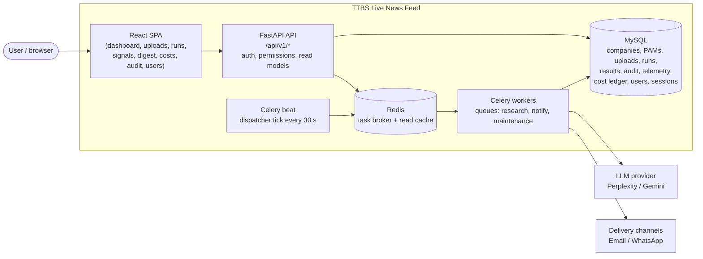
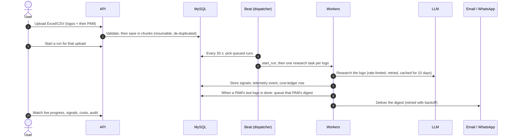
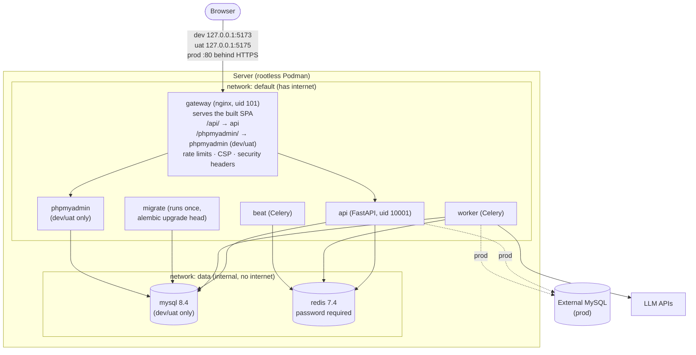

# TTBS Live News Feed

TTBS Live News Feed researches business news about the companies (logos) in an uploaded list and
sends each account manager (PAM) a digest about their own companies.

You upload an Excel/CSV file that lists logos and the PAM who owns each one. A research run then
asks an LLM (Perplexity or Gemini, with web search) for recent signals about every logo:
- funding
- leadership changes
- expansion
- tenders, and similar

The results go into a single digest per PAM, delivered by email or WhatsApp. Every step is:
- audited, in a hash-chained audit log
- measured, as telemetry
- costed, in the FinOps ledger

| | |
|---|---|
| **Backend** | Python 3.12, FastAPI, SQLAlchemy 2 + Alembic, Celery + Redis |
| **Database** | MySQL 8.4 (SQLite for tests and quick local runs) |
| **Frontend** | React 19, TypeScript, Vite, TanStack Query, Tailwind + shadcn/ui |
| **Gateway** | nginx 1.30 (unprivileged): serves the SPA and routes `/api/` |
| **Runtime** | Podman + podman-compose (Docker Compose also works) |
| **Scale target** | 10,000 logos, 5,000 PAMs, 40k+ research results ([docs/scale-and-live-progress.md](docs/scale-and-live-progress.md)) |

---

## Contents

1. [High-level architecture](#high-level-architecture)
2. [Deployment architecture](#deployment-architecture)
3. [Repository layout](#repository-layout)
4. [Quick start](#quick-start)
5. [Command reference](#command-reference)
6. [Configuration](#configuration)
7. [Security](#security)
8. [Troubleshooting](#troubleshooting)

---

## High-level architecture



### The research flow



Key design points:
- **Every run starts from an upload.** A run covers only that upload's logos and delivers to the
  PAMs that upload mapped them to. You can re-run an older upload later.
- **Queues are separate**, so a 10,000-logo research backlog never delays notifications.
- **Tasks are idempotent.** A sweeper re-queues work that is stuck or was lost.
- **Research results are reused for `RESEARCH_WINDOW_DAYS` (10).** A reused result costs nothing,
  and the ledger records it with the estimated saving.
- **One active LLM provider at a time.** It is chosen in the UI (Providers & channels), and its
  API key is stored AES-GCM-encrypted with `SECRETS_KEY`.
- **Budget is a hard cap.** New runs are refused once month-to-date spend reaches
  `MONTHLY_BUDGET_USD`.
- **Sign-in is required for everything.** Admins manage users and per-module permissions (view /
  manage) on the *Users & access* page.

Backend internals (audit, telemetry, retries, providers): [backend/README.md](backend/README.md).

---

## Deployment architecture

Every environment runs the same stack. Only the gateway publishes a port.



| | dev | uat | prod |
|---|---|---|---|
| Settings file | `.env.dev` | `.env.uat` | `.env.prod` |
| `ENV` | `dev` (API docs at `/docs`) | `prod` | `prod` |
| Database | MySQL container | MySQL container | external server (`DATABASE_URL`) |
| phpMyAdmin | `/phpmyadmin/` (password gate) | `/phpmyadmin/` (password gate) | not in the image |
| Listens on | `127.0.0.1:5173` | `127.0.0.1:5175` | `GATEWAY_BIND:GATEWAY_PORT` (default `0.0.0.0:80`) |
| Host | this server | this server | a separate server; TLS terminated in front |

Startup order:
1. `redis` and `mysql` become healthy.
2. `migrate` applies the database migrations and exits.
3. `api`, `worker` and `beat` start.
4. `gateway` starts once `api` is healthy.

On first start the API creates the first admin from `ADMIN_*`.

Container hardening:
- every service: `no-new-privileges`
- app containers (api, worker, beat, migrate, gateway): non-root, read-only root file system,
  `cap_drop: ALL`
- MySQL and Redis are reachable only on the internal `data` network

Data lives in named volumes `ttbs-<stage>_mysql_data`, `_redis_data` and `_uploads`. These survive
`up` and `down`.

Images built from this repo:

| Image | Built from | Contents |
|---|---|---|
| `ttbs-backend:<stage>` | [backend/Dockerfile](backend/Dockerfile) | The API, Celery worker/beat and migrations (code obfuscated with PyArmor) |
| `ttbs-gateway:<stage>` | [deploy/nginx/Dockerfile](deploy/nginx/Dockerfile) | Stage 1 builds the SPA with Node 24; stage 2 is nginx with the built files and config |

How to run it: [deploy/README.md](deploy/README.md). Security controls: [docs/security.md](docs/security.md).

---

## Repository layout

```
.
├── README.md                  this file
├── deploy.sh                  ./deploy.sh <dev|uat|prod> <command>
├── compose.yml                the stack (every environment)
├── compose.db.yml             dev/uat add-on: MySQL + phpMyAdmin
├── .env.example               every deployment setting → copy to .env.<stage>
├── deploy/
│   ├── README.md              deployment one-pager
│   ├── phpmyadmin.php         phpMyAdmin hardening (no root login)
│   └── nginx/                 gateway image: Dockerfile, nginx.conf, headers.conf, tools.conf
├── backend/
│   ├── app/
│   │   ├── api/               routes, auth routes, permission guard (deps.py), schemas
│   │   ├── core/              config, permissions, cache, errors, logging, metrics, tracing
│   │   ├── db/                SQLAlchemy models and session
│   │   ├── services/          business logic: imports, runs, auth, audit, finops, telemetry
│   │   ├── research/          LLM providers (Perplexity, Gemini), prompts, parser, rate limit
│   │   ├── notify/            delivery channel adapters
│   │   └── worker/            Celery app and tasks
│   ├── migrations/            Alembic migrations
│   ├── tests/                 pytest (SQLite + fakeredis; touches nothing shared)
│   └── Dockerfile
├── frontend/
│   └── src/                   pages/, components/, api/ (typed client + hooks), context/, lib/
└── docs/
    ├── security.md            VAPT reference: every control and how to verify it
    ├── caching-policy.md      what is cached where, and for how long
    └── scale-and-live-progress.md
```

---

## Quick start

On a server that has `podman` and `podman-compose`:

```bash
git clone <repo-url> ttbs_live_news_feed && cd ttbs_live_news_feed

cp .env.example .env.dev && chmod 600 .env.dev
#   fill in: every CHANGE_ME, SECRETS_KEY, ADMIN_INITIAL_PASSWORD, GATEWAY_PMA_HTPASSWD
#   (the generators are listed under "Command reference → Secrets")

./deploy.sh dev up
./deploy.sh dev ps            # wait until api and gateway show (healthy)
```

Then:
1. Open http://localhost:5173 and sign in as `admin` with `ADMIN_INITIAL_PASSWORD`.
2. Set a new password when prompted. This is required at first sign-in.
3. Delete `ADMIN_INITIAL_PASSWORD` from `.env.dev`.
4. In the UI, go to **Providers & channels** and enter the Perplexity or Gemini API key.

From another machine, the environments listen on localhost only, so use an SSH tunnel:

```bash
ssh -L 5173:localhost:5173 -L 5175:localhost:5175 user@server
```

---

## Command reference

### Deploy and operate (`deploy.sh`)

`./deploy.sh <stage> <command> [args]`, where `<stage>` is `dev`, `uat` or `prod`.

| Command | What it does |
|---|---|
| `./deploy.sh dev up` | Build the images and (re)create every container. Volumes are kept. |
| `./deploy.sh dev up api` | Rebuild and restart one service (plus the services it depends on). |
| `./deploy.sh dev ps` | Container status and health |
| `./deploy.sh dev logs` | Follow the logs of all services (last 100 lines each) |
| `./deploy.sh dev logs api` | Follow one service's logs |
| `./deploy.sh dev stop` | Stop the containers and keep them |
| `./deploy.sh dev start` | Start the stopped containers again |
| `./deploy.sh dev restart worker` | Restart one service without rebuilding |
| `./deploy.sh dev down` | Stop and remove the containers. Volumes (data) are kept. |
| `./deploy.sh dev config` | Print the fully resolved compose file. This shows the secrets from `.env.dev`, so don't share or log the output. |
| `./deploy.sh dev exec api <cmd>` | Run a command inside a running container |

Container names are `ttbs-<stage>_<service>_1`, for example `ttbs-uat_api_1`. Plain `podman`
commands work on them too:

```bash
podman ps --filter name=ttbs-                  # every TTBS container
podman logs -f --tail 200 ttbs-dev_worker_1
podman stats --no-stream $(podman ps -q --filter name=ttbs-dev)
podman volume ls | grep ttbs-
```

### Database

```bash
# Migration status, and upgrading by hand (`up` already runs migrations automatically)
./deploy.sh dev exec api alembic current
./deploy.sh dev exec api alembic history | head
./deploy.sh dev run --rm migrate               # run the migrate step once more

# MySQL shell, as the application user (dev/uat)
podman exec -it ttbs-dev_mysql_1 sh -c 'mysql -u"$MYSQL_USER" -p"$MYSQL_PASSWORD" "$MYSQL_DATABASE"'

# Backup and restore (dev/uat)
podman exec ttbs-dev_mysql_1 sh -c 'mysqldump --single-transaction -u"$MYSQL_USER" -p"$MYSQL_PASSWORD" "$MYSQL_DATABASE"' \
  > backup-dev-$(date +%F).sql
podman exec -i ttbs-dev_mysql_1 sh -c 'mysql -u"$MYSQL_USER" -p"$MYSQL_PASSWORD" "$MYSQL_DATABASE"' < backup-dev-2026-01-31.sql

# Web UI (dev/uat): http://localhost:5173/phpmyadmin/  (gate user dbadmin, then the MySQL user; root is refused)
```

Prod's database is external. Back it up with your database team's tooling, using the same
`mysqldump --single-transaction` approach.

### Secrets

```bash
# SECRETS_KEY: 32 random bytes, url-safe base64 (one per environment; back it up)
python3 -c "import base64,os;print(base64.urlsafe_b64encode(os.urandom(32)).decode())"

# A random password (MySQL, Redis; letters and digits only, so it is URL-safe)
python3 -c "import secrets,string;a=string.ascii_letters+string.digits;print(''.join(secrets.choice(a) for _ in range(32)))"

# GATEWAY_PMA_HTPASSWD: the phpMyAdmin gate line (bcrypt). Paste it into .env.<stage> in single quotes.
printf '%s' 'YOUR-STRONG-PASSWORD' | podman run --rm -i docker.io/library/phpmyadmin:5.2.3 htpasswd -niB -C 12 dbadmin

chmod 600 .env.dev .env.uat .env.prod
```

`ADMIN_INITIAL_PASSWORD` must meet the password policy:
- at least 12 characters
- upper case, lower case, a digit and a symbol
- no common words, and not the username

### Users

User management lives in the UI: **Administration → Users & access**. Admins can:
- create users (the API issues a one-time temporary password)
- set per-module permissions
- reset passwords and unlock accounts
- sign users out everywhere
- deactivate users

If every admin is locked out, wait 15 minutes for the lockout to expire, or clear it in the
database:

```bash
podman exec ttbs-dev_mysql_1 sh -c 'mysql -u"$MYSQL_USER" -p"$MYSQL_PASSWORD" "$MYSQL_DATABASE" \
  -e "UPDATE users SET failed_login_count=0, locked_until=NULL WHERE username=\"admin\""'
```

### Local development (without containers)

Backend. By default it uses SQLite (`backend/ttbs_dev.db`) and expects Redis on `localhost:6379`:

```bash
cd backend
python3.12 -m venv .venv && source .venv/bin/activate     # Windows: .venv\Scripts\activate
pip install -r requirements-dev.txt
cp .env.example .env                                     # set SECRETS_KEY and ADMIN_INITIAL_PASSWORD
alembic upgrade head

uvicorn app.main:app --reload --port 8010                                                       # terminal 1
celery -A app.worker.celery_app worker -P threads -c 16 -Q research,notify,maintenance -l INFO  # terminal 2
celery -A app.worker.celery_app beat -l INFO                                                    # terminal 3
```

To run without paying for LLM calls, set `LLM_PROVIDER=fake` in `backend/.env`.

Frontend. The Vite dev server calls the API at `http://localhost:8010` (`frontend/.env.development`):

```bash
cd frontend
npm ci
npm run dev        # http://localhost:5173
```

The backend allows CORS only from `localhost:5173` by default. If the dev stack's gateway already
holds port 5173, Vite moves to 5174. In that case, either run `./deploy.sh dev stop` first, or
set `CORS_ORIGINS=["http://localhost:5174"]` in `backend/.env`.

### Tests, lint and build

```bash
# Backend tests (SQLite + fakeredis, eager Celery: touches no shared service)
cd backend && pytest                       # or one file: pytest tests/test_auth.py -q
ruff check app tests

# Backend tests in a container (no local Python needed)
podman build -t ttbs-backend-test -f - backend <<'EOF'
FROM docker.io/library/python:3.12-slim
COPY requirements-dev.txt requirements.txt /tmp/
RUN sed -i '1s/^\xEF\xBB\xBF//' /tmp/requirements-dev.txt && pip install --no-cache-dir -r /tmp/requirements-dev.txt
WORKDIR /src
EOF
podman run --rm -v ./backend:/src:z ttbs-backend-test python -m pytest -q

# Frontend
cd frontend
npm run lint
npm run build              # type-check (tsc -b) + production bundle in dist/
npm run preview            # serve dist/ locally

# Dependency audits
cd frontend && npm audit --omit=dev
cd backend && pip install pip-audit && pip-audit -r requirements.txt
```

### Security checks against a running stack

```bash
export NO_PROXY='*'   # bypass the corporate proxy for localhost

curl -sI http://127.0.0.1:5173/                    # CSP, X-Frame-Options, nosniff, no nginx version
curl -s  http://127.0.0.1:5173/api/v1/health       # {"status":"ok",...}
curl -s  -o /dev/null -w '%{http_code}\n' http://127.0.0.1:5173/api/v1/runs   # 401: sign-in required
curl -s  -o /dev/null -w '%{http_code}\n' http://127.0.0.1:5173/.env          # 404
for i in $(seq 8); do curl -s -o /dev/null -w '%{http_code} ' -X POST -H 'Content-Type: application/json' \
  -d '{"username":"x","password":"y"}' http://127.0.0.1:5173/api/v1/auth/login; done; echo   # 401 ... then 429
```

The full checklist is in [docs/security.md](docs/security.md#verifying).

### Code intelligence (GitNexus)

The repository is indexed by GitNexus (see [CLAUDE.md](CLAUDE.md)):

```bash
node .gitnexus/run.cjs analyze --index-only                          # refresh the index
node .gitnexus/run.cjs impact "symbolName" --direction upstream --repo .   # blast radius before editing
node .gitnexus/run.cjs detect-changes --scope all --repo .           # before committing
```

---

## Configuration

Every deployment setting is in [.env.example](.env.example), with notes on what differs per
stage. Copy it to `.env.<stage>`. These files are git-ignored, kept out of build contexts, and
should be mode 600.

| Group | Variables | Notes |
|---|---|---|
| Environment | `ENV`, `LOG_LEVEL` | `ENV=prod` also turns off `/docs` and `/openapi.json` |
| Database | `DATABASE_URL`, `MYSQL_*` | `MYSQL_*` creates the dev/uat container; prod uses only `DATABASE_URL` |
| Redis | `REDIS_PASSWORD`, `BROKER_URL`, `REDIS_CACHE_URL` | The URLs must contain the same password |
| Encryption | `SECRETS_KEY` | Encrypts the stored LLM API keys. Losing or changing it makes them unreadable. |
| Research | `LLM_PROVIDER`, `RESEARCH_WINDOW_DAYS`, `LLM_RATE_PER_SECOND`, `RESEARCH_MAX_RETRIES` | `fake` = offline. The provider key and model are set in the UI. |
| Delivery | `NOTIFY_EMAIL_ADAPTER`, `NOTIFY_WHATSAPP_ADAPTER`, `NOTIFY_MAX_ATTEMPTS` | `console` = log the message instead of sending it |
| Budget | `MONTHLY_BUDGET_USD`, `BUDGET_SOFT_LIMIT_PCT`, `BUDGET_HARD_CAP` | Hard cap = new runs are refused once the budget is reached |
| First admin | `ADMIN_USERNAME`, `ADMIN_NAME`, `ADMIN_INITIAL_PASSWORD` | Used only while no user exists. Delete the password once the admin has signed in. |
| Sessions | `SESSION_IDLE_MINUTES` (30), `SESSION_MAX_HOURS` (12), `SESSION_COOKIE_SECURE` | The cookie is `Secure`: use HTTPS, or `localhost` |
| Lockout and passwords | `AUTH_MAX_FAILED_ATTEMPTS` (5), `AUTH_LOCKOUT_MINUTES` (15), `PASSWORD_MIN_LENGTH` (12), `PASSWORD_HISTORY_COUNT` (5), `PASSWORD_MAX_AGE_DAYS` (90) | |
| Gateway | `GATEWAY_PMA_HTPASSWD`, `GATEWAY_BIND`, `GATEWAY_PORT` | The only values the gateway receives. The bind and port settings apply to prod; dev/uat are fixed to localhost. |
| Observability | `METRICS_WORKER_PORT`, `OTEL_EXPORTER_OTLP_ENDPOINT` | Prometheus `/metrics` is internal only; OTLP traces are exported when the endpoint is set |

Gateway behaviour (rate limits, body limits, headers, caching) is configured in
[deploy/nginx/nginx.conf](deploy/nginx/nginx.conf). Rebuild after changing it:
`./deploy.sh <stage> up`.

---

## Security

The full VAPT reference, with every control, where it lives and how to verify it, is
[docs/security.md](docs/security.md). In short:

- **Authentication:**
  - Argon2id password hashes
  - strong password policy with history and expiry
  - forced password change at first sign-in
  - account lockout and generic error messages
  - server-side sessions in an `HttpOnly` + `Secure` + `SameSite=Strict` cookie
  - a CSRF token on every write
- **Authorisation:**
  - roles `admin` and `member`, with per-module `view` / `manage` permissions
  - one guard on every API route; it fails closed, and a test fails the build if a route has no
    rule
- **Gateway:**
  - per-IP rate limits (login 6 per minute, API 20 per second)
  - size and time limits on requests, and a method allow-list
  - CSP and security headers; no version banners
  - `X-Forwarded-For` cannot be spoofed
- **Caching:** API responses use `no-store`, built assets are cached for 1 year (hashed file
  names), and the page shell is always revalidated. See
  [docs/caching-policy.md](docs/caching-policy.md).
- **Audit:** hash-chained log of every sign-in, failure, lockout, admin action and data change
  (`GET /api/v1/audit/verify`).

**Before go-live in prod:**
1. Put HTTPS in front of the gateway.
2. Enable HSTS in `deploy/nginx/headers.conf`.
3. If a load balancer sits in front, enable `real_ip` in `nginx.conf`.

---

## Troubleshooting

| Symptom | Cause and fix |
|---|---|
| Sign-in "works" but every next request returns 401 | The browser drops the `Secure` cookie on plain HTTP unless the host is `localhost` / `127.0.0.1`. Use an SSH tunnel, or HTTPS. |
| `curl` to localhost returns `400 Cycle Detected` or a proxy page | The corporate proxy intercepts the request. Run `export NO_PROXY='*'` (healthchecks already use `wget -Y off`). |
| Container exits with code 126, or "permission denied" on files | The host umask is 027. The Dockerfiles already `chmod` what they copy; rebuild with `./deploy.sh <stage> up`. |
| A config change does not show | The config is baked into the images: run `./deploy.sh <stage> up`, which rebuilds and recreates. |
| `429 rate_limited` for everyone at once | Rootless Podman makes every client appear to come from one IP, so per-IP limits act as one shared limit. Prod on rootful Docker/Podman, or behind a load balancer with `real_ip`, does not have this. |
| `password_change_required` (403) on every page | The password is new, temporary or expired. Change it at `/change-password`. |
| `/docs` returns 404 | The API docs exist only with `ENV=dev`, so only on the dev stack. |
| Port 5173 / 5175 already in use | Another stack or a Vite dev server holds the port. Check with `ss -ltnp \| grep 517`. |
| `migrate` keeps failing | Run `./deploy.sh <stage> logs migrate`. The usual causes are a wrong `DATABASE_URL`, or a database that is not reachable from containers. In prod, use `host.docker.internal` for MySQL on the same host. |
